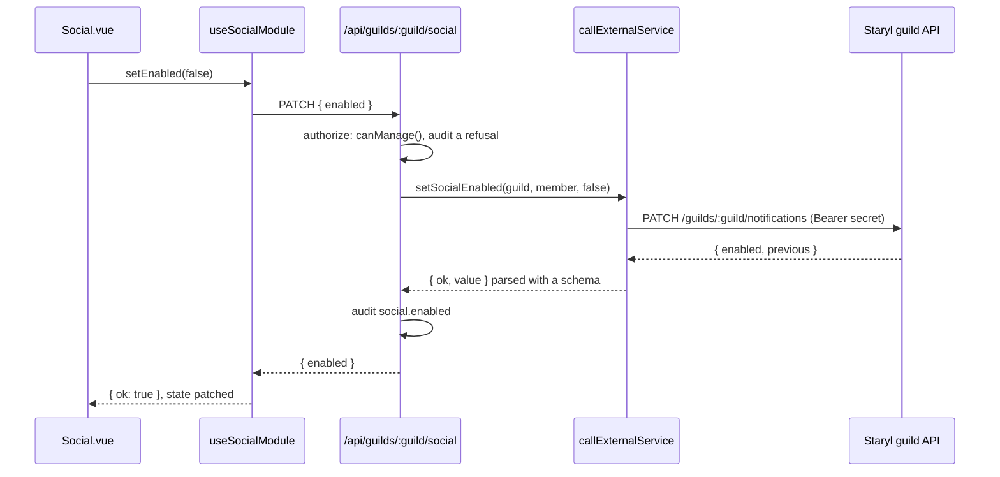

# External modules

Read before adding a module whose data is in another service, or changing the Social module.

A module of the dashboard is a feature with a switch and a section. Most modules are WolfStar's: their
switch is a key of `GuildData`, and the dashboard reads and writes WolfStar's database. An external
module is held by another service of the WolfStar Project. The dashboard never reads that service's
database. It calls the service's HTTP API, server to server.

**Social** is the first one. Staryl holds it: the switch of a server's notifications and its
subscriptions. Staryl's side of the contract is `docs/guild-api.md` in wolfstar-project/staryl.

## The decisions

| Question                               | Answer                                                   | Why                                                                                                                                                                                 |
| -------------------------------------- | -------------------------------------------------------- | ----------------------------------------------------------------------------------------------------------------------------------------------------------------------------------- |
| Who holds the "enabled" state?         | The service that owns the module                         | A switch in WolfStar's database would only hide a page. The service would not know of it, and would keep working. The service's own switch stops the work and keeps the data.       |
| How does the dashboard sign in?        | A secret the two share, sent as a bearer token           | The call is server to server. The member's Discord token stays in the dashboard. The service needs no session store and no second permission check.                                 |
| Who checks the member?                 | The dashboard, in the route's `authorize` hook           | The secret acts for every server. The service trusts its holder, so a route that skips `authorize` gives every signed-in member every server.                                       |
| How does the page stay current?        | It reads on open and after each write. There is no push. | The state changes rarely, and a member who waits for a status can reload. A webhook from the service would need a second secret, a public route and a retry policy for little gain. |
| Are the writes staged?                 | No. Each call writes at once                             | The staged-changes bar saves `GuildData` in one transaction. A call to another service cannot join that transaction, so it cannot be rolled back with it.                           |
| Is the module counted with the others? | No                                                       | "N / M enabled", Enable all and Disable all are about the staged switches. The Modules page shows external modules in a group of their own, under the name of their bot.            |

## The parts

| Part               | File                                              | Does                                                                                                                  |
| ------------------ | ------------------------------------------------- | --------------------------------------------------------------------------------------------------------------------- |
| Registry entry     | `shared/utils/guild-modules.ts`                   | `EXTERNAL_GUILD_MODULES` names the module, its icon, its section and the bot that runs it                             |
| Shapes             | `shared/utils/social.ts`                          | Valibot schemas of the service's answers and of the request bodies, and the error codes                               |
| Service client     | `server/utils/external-service.ts`                | `callExternalService()` sends the secret, reads a refusal as a value, parses the answer. It is the same for a service |
| The module's calls | `server/utils/social/staryl.ts`                   | One function per call of Staryl's API. Reads the URL and the secret from the runtime config                           |
| Route helpers      | `server/utils/social/route.ts`                    | The `authorize` hook, the mapping of a failure to a status and a code, and the audit events                           |
| Routes             | `server/api/guilds/[guild]/social/**`             | `GET` and `PATCH` on the module, `POST` and `DELETE` on its subscriptions                                             |
| Composable         | `app/composables/useSocialModule.ts`              | The state, its `status`, and the calls. Each call answers `{ ok, value }` or `{ ok, code }`                           |
| Section            | `app/components/guild/settings/Social.vue`        | The page, with the switch in `GuildModuleBanner`                                                                      |
| Card               | `app/components/guild/ExternalModuleCard.vue`     | The module's card on the Modules page. It is the same for every external module                                       |
| Navigation         | `app/utils/dashboard-nav.ts`, `app/pages/app.vue` | The sidebar entry, without a `moduleKey`, and the section's component                                                 |

## Rules

- **Never call the service from the client.** The secret is server-only. A component calls the
  dashboard's own route.
- **Every route takes an `authorize` hook built with `authorizeGuildManager()`.** The service checks no
  member. The hook is the only gate, and it audits a refusal.
- **Parse the answer where it enters.** `callExternalService()` takes a schema. An answer of another shape
  is `invalid-answer`, which the route answers with 503. A component never sees an unparsed answer.
- **A failure is a value.** `callExternalService()` throws nothing. Its error is one of four kinds:

    | Kind             | Means                                                  | The route answers             |
    | ---------------- | ------------------------------------------------------ | ----------------------------- |
    | `not-configured` | The deployment has no URL or no secret for the service | 503, code `unavailable`       |
    | `unreachable`    | No answer, a 5xx, a 401, or a 4xx without a code       | 503, code `unavailable`       |
    | `refused`        | The service said no, with a code of its own            | The service's status and code |
    | `invalid-answer` | The answer does not match the schema                   | 503, code `unavailable`       |

- **The member reads a code, never the service's words.** The route passes on a code the dashboard has a
  sentence for, and `generic` for any other. The sentences are under `guild_settings.social.errors`.
- **Validate what goes into a path.** A path parameter that is passed on to the service is checked first.
  `[source].delete.ts` refuses anything that is not a number.
- **Audit every change.** The module has no settings key, so its events are `guild.settings.update` with
  a key of their own: `social.enabled` for the switch, `social.<channel>.<source>` for a subscription.
  The service answers with what the value was before, so a repeat of the same value records nothing.
- **A write that went through stays a success.** Staryl answers an add or a remove with the new list. If it
  saved the write and could not read the list, it answers `subscriptions: null`. The composable then reads
  the list again. It never sends the write again, which would answer `duplicate` or `subscription-not-found`.
- **Say why there is nothing to configure.** The composable's `status` is `loading`, `unavailable`,
  `not-installed` or `ready`. Only `ready` has a switch. The page and the card show the other three as
  they are, and never as "off".
- **Show what the service can do, and what it cannot yet.** The add dialog lists Twitch live and every
  platform Staryl answers as `manageable`. One Staryl has no credentials for (`configured: false`, or
  `twitchLiveConfigured: false`) is listed, disabled, as "not on Staryl yet": an admin sees it exists,
  and no add is sent that Staryl would refuse. The dashboard holds no list of its own, so `COPY.md`'s
  claims about Staryl's platforms hold without a second place to edit.

## Configuration

| Variable                 | Holds                                                    |
| ------------------------ | -------------------------------------------------------- |
| `NUXT_STARYL_API_URL`    | The root of Staryl's API: its `API_PORT`, without a path |
| `NUXT_STARYL_API_SECRET` | The same value as Staryl's `GUILD_API_SECRET`            |

Both are server-only keys of the runtime config (`starylApiUrl`, `starylApiSecret`). On a Worker, set both
with `wrangler secret put`. If either is empty, the routes answer 503 and the page says that Social is
not available. Nothing else in the dashboard depends on them.

## What Social does not do yet

- It does not edit a subscription. To change one, remove it and add it again.
- It does not set filters. A subscription's filters are set with `/subscriptions` in Discord, and the page
  keeps them when it lists the subscription.
- It lists the subscriptions of connected accounts (Instagram, TikTok) and does not change them. Staryl
  answers these with `manageable: false`, since the connection starts in Discord.
- Twitch live has no limit and no switch of its own. An end-of-stream notification needs a message, as
  `/subscriptions twitch add` asks. A Twitch live row from a Staryl without the Twitch live routes has no
  `subscriptionId`, and the page offers no removal for it.
- The dashboard opens only for a server WolfStar is in. A server with Staryl alone has no dashboard.

## Adding another external module

1. In the service, add routes behind a secret. Answer an error as `{ "error": "<code>" }`. Hold the
   module's switch in the service, and answer a write with the value before it.
2. Add the URL and the secret to `generateRuntimeConfig()` and to `.env.example`.
3. Add `shared/utils/<module>.ts` with the schemas and the error codes.
4. Add `server/utils/<module>/<service>.ts` with one function per call, each through
   `callExternalService()`.
5. Add `server/utils/<module>/route.ts` and the routes under `server/api/guilds/[guild]/<module>/`.
6. Add the composable, the section, the entry of `EXTERNAL_GUILD_MODULES`, the entry of `DASHBOARD_NAV`
   and the component in `app/pages/app.vue`. `Modules.vue` maps each key of the registry to its
   composable.
7. Add the module to `GLOSSARY.md`, its strings to `i18n/locales/en/`, and its accessibility checks to
   `test/nuxt/a11y.spec.ts`.
